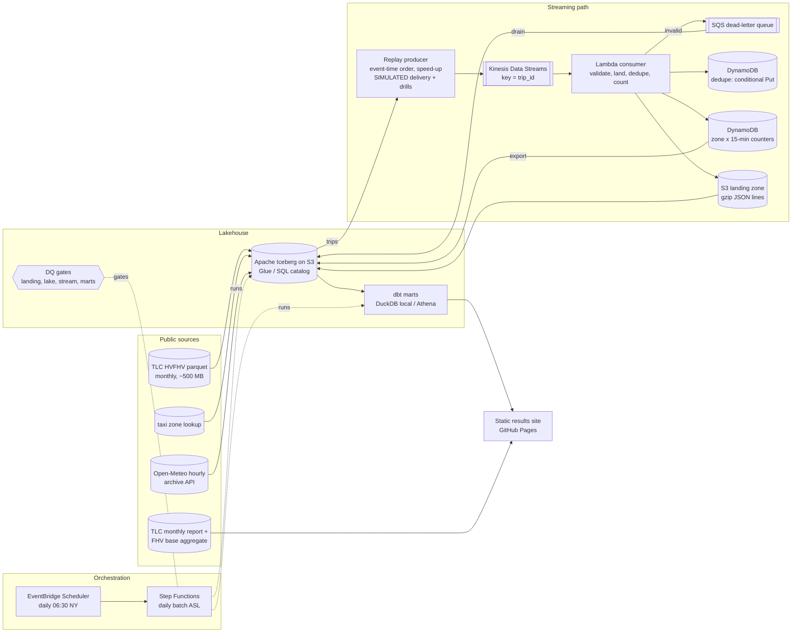

# Uber rides streaming on AWS (emulated)

[](https://github.com/rohit91jacob/uber-rides-streaming-aws/actions/workflows/ci.yml)
[](https://github.com/rohit91jacob/uber-rides-streaming-aws/actions/workflows/refresh.yml)
[](https://rohit91jacob.github.io/uber-rides-streaming-aws/)
[](LICENSE)
[](DATA_LICENSE.md)

A ride-hailing data platform built the way it would run on AWS, from **real NYC Taxi &
Limousine Commission trip records for Uber** (licence `HV0003`, about 15 million trips a month).
Each trip is turned into four ride lifecycle events (requested, driver on scene, picked up,
dropped off) and replayed in event-time order into **Kinesis**. A **Lambda** consumer
validates them, dead-letters bad records to **SQS**, deduplicates with **DynamoDB conditional
transactions** and keeps exactly-once real-time zone supply/demand counters (a surge proxy).
Events and the monthly batch land in **Apache Iceberg** tables, **dbt** builds the analytics
marts (DuckDB locally, Athena on AWS) and a **Step Functions** state machine started daily by
**EventBridge Scheduler** orchestrates the batch with data-quality gates between layers.

**What is real and what is emulated.** The trip, zone, weather and report data are real public
data, downloaded at runtime. The AWS services are **emulated** (moto in-process locally,
LocalStack in a CI job); the infrastructure is Terraform that is validated, linted and
security-scanned but has **never been applied to an AWS account**. The only simulated things
are the *delivery* of events as a live feed and the seeded fault-injection drills (duplicate
and corrupted records), and they are labelled as simulated everywhere.

## Results (June 2026, real data, from an actual local run)

| | |
|---|---:|
| Uber trips loaded (raw HV0003 rows = Iceberg trips + quarantine) | **15,257,740** = 15,257,740 + 0 |
| Avg trip miles / base fare / driver pay | 5.08 / $29.40 / $22.60 |
| Driver pay as a share of base fare (fare > 0) | 76.8% |
| Driver pay + tips as a share of everything the rider paid | 64.9% |
| Request-to-pickup wait, median / p90 (trips picked up at or after the request) | 4.7 / 11.3 min |
| Trips picked up within 10 minutes of the request (not scheduled: request not after driver on scene) | 86.4% |
| Trips charged the Congestion Relief Zone (CBD) fee | 4,912,000 (32.2%), $7,368,000 at $1.50 each |
| Airport trips (LGA / JFK / EWR) | 631,116 / 569,840 / 114,750 |
| Shared-ride requests / matched (match rate) | 412,276 / 256,422 (62.2%) |
| Demand index in moderate rain (1-4 mm/h, 25 hours) vs dry hours | 1.095 vs 0.998 |
| Trips that start and end in the same borough | 70.4% |
| Streaming replay (2% sample of 17:00-18:00 on 12 June, replayed twice with drills) | 7,194 records read, 2,916 accepted exactly once, 3,748 duplicates absorbed, 530 malformed to the DLQ, 1,936 counter cells = batch recount, 0 mismatches |
| dbt build | 91 nodes: 90 pass, 1 warning (2 trips logged at > 1,000 miles) |
| Data-quality gates (landing, lake, stream, marts) | 26 checks, 0 errors |
| Wall time, whole state machine (Windows laptop, file already cached) | 5 min 21 s idle; 16 min on a heavily loaded machine (review rerun) |

The trip, fare, pay-share, wait, CBD, airport, shared-ride, weather, borough, streaming and
gate figures are printed by `uber-rides report` (results site and `site/summary.json`); the
pay + tips share and the airport split are sums over the site's per-borough and per-direction
tables; dbt counts come from the `transform` step log.

**Verification against the TLC's own published figures** ([docs/verification.md](docs/verification.md)):
for May 2026 the FHV Base Aggregate Report gives Uber 15,354,816 dispatched trips and Lyft
6,770,928; the raw trip file has exactly those numbers (0.00%). The TLC monthly report's
HVFHS trips per day for May (713,730) is within 0.001% of the file. For June 2026 the monthly
report is **2.14% higher** than the published trip file (707,670 vs 692,529 trips/day) and
the June base aggregate is not published yet; that gap is reported, not explained away.
Verification also showed that the base report counts *matched* shared rides for Uber but
shared *requests* for Lyft.

The [results site](https://rohit91jacob.github.io/uber-rides-streaming-aws/) is regenerated
monthly by `refresh.yml` when a new TLC month appears.

## Architecture



The batch state machine (same JSON file locally and in Step Functions):
`ResolveMonth -> NewMonth? -> IngestMonth -> GateLanding -> LoadLake -> GateLake -> (ReplayWindow) -> LoadEvents -> GateStream -> Transform (dbt build) -> GateMarts`.
Any error-level gate failure ends in `QualityGateFailed`; any step exception (after retries)
ends in `BatchFailed`.

## Components

| Component | Code | What it does |
|---|---|---|
| TLC ingest | `src/uber_rides/sources/tlc.py`, `http.py` | Conditional, atomic downloads with a sha256 manifest; schema check of the 25 HVFHV columns; per-licensee and per-base source profile |
| Weather ingest | `sources/weather.py` | Open-Meteo hourly archive for central NYC, local time (aligns with TLC timestamps) |
| Published figures | `sources/published.py`, `verify.py` | TLC monthly report and FHV base aggregate (Socrata) for reconciliation |
| Iceberg loads | `lake/load.py`, `lake/tables.py` | Uber-only trips with deterministic ids and flags; hard-rule quarantine; month replaced in one Iceberg transaction (idempotent) |
| Replay producer | `streaming/producer.py`, `events.py` | Real trips -> lifecycle events, sorted by event time, `PutRecords` with retry, speed-up factor, seeded duplicate/corruption drills |
| Lambda consumer | `streaming/consumer.py` | Validation, SQS DLQ, deterministic S3 landing object per batch, `TransactWriteItems` of conditional dedupe Puts + pre-aggregated counter `ADD`s (<= 100 items), `ReportBatchItemFailures` |
| Event source stand-in | `streaming/poller.py` | Reproduces the Lambda Kinesis event source contract (batches, partial-failure retry from a sequence number, on-failure destination) against moto/LocalStack |
| Event loader | `lake/events_load.py` | Landing zone -> Iceberg `ride_events`, incremental by landing object |
| Serving views | `lake/serving.py` | DuckDB views over each Iceberg table's *current snapshot* (the local stand-in for Athena on Glue) |
| Quality gates | `quality/gates.py` | SQL checks per layer, thresholds, error vs warn, results to Iceberg `dq_results` |
| dbt | `dbt/` | staging -> intermediate -> 14 marts, 71 data tests incl. 2 singular reconciliation tests; DuckDB and Athena targets |
| Orchestration | `orchestration/daily_batch.asl.json`, `asl.py`, `steps.py` | ASL definition shared by Terraform and a local interpreter (Task/Choice/Retry/Catch), Lambda step handler |
| Results site | `report.py` | Static HTML + `summary.json` from the marts and ops JSON |
| Infrastructure | `infra/` | Terraform: KMS, S3 + Glue + Athena, Kinesis + Lambda + DynamoDB + SQS + alarms, Step Functions + Scheduler + ECR, budget, GitHub OIDC deploy role (workload roles capped by a permissions boundary; see the runbook) |

## Tech stack

| Layer | Tool (version in `uv.lock` / pins) |
|---|---|
| Language / packaging | Python 3.12, uv 0.10 (`uv.lock`) |
| AWS SDK / emulation | boto3 1.43, moto 5.2 (in-process), LocalStack 4.14.0 (CI service container) |
| Table format | Apache Iceberg via pyiceberg 0.12 (SQL catalog on SQLite locally, Glue catalog on AWS) |
| Query engine | DuckDB 1.5.6 locally; Amazon Athena engine v3 (Trino) on AWS |
| Transformations | dbt-core 1.12, dbt-duckdb 1.11, dbt-athena-community 1.11 (compile-checked in CI) |
| Arrow | pyarrow 26 |
| IaC | Terraform 1.16.5, AWS provider ~> 6.68, tflint 0.64 + AWS ruleset 0.49, checkov 3.3.26 |
| Quality / CI | ruff 0.16, pytest 9, pre-commit (ruff, gitleaks 8.30, terraform fmt, large-file guard), GitHub Actions |

## Design rationale

Five constraints drove the design. The data is **real and public**: each monthly TLC file is
about 500 MB with some 15 million Uber trips, and `uber-rides verify` reconciles it with the
TLC's own published figures. Everything must **run without an AWS account or credentials**, on a
Windows laptop with no Docker and on free GitHub-hosted runners, scheduled refresh included.
**Local code is deployment code**: the state machine JSON, both Lambda handlers and the dbt
project are what `infra/` and the `Dockerfile` package, though that Terraform has never been
applied. Every step must be **safe to rerun and reproducible** (locked dependencies,
deterministic ids, seeded drills), and a deployment must stay under a **small cost ceiling**.

### Architecture decisions

| Decision | Why | Alternatives considered | Trade-off accepted |
|---|---|---|---|
| **Real events, simulated delivery.** Each trip becomes four lifecycle events stamped with its real TLC times (`streaming/events.py`), replayed in event-time order with `trip_id` as the partition key | There is no public ride-event feed, but TLC records carry request, on-scene, pickup and dropoff times, so the stream can be reconciled exactly with the batch. One key per trip keeps its events in order on one shard; duplicates and corrupt records come from seeded drills and are labelled simulated | A synthetic ride generator (no ground truth to reconcile with); one event per trip (no lifecycle for the zone counters) | No cancellations or driver positions, so supply is a proxy (each dropoff frees a driver); `produced_at` and replay pacing are not real timings |
| **Exactly-once counters through DynamoDB transactions** (`streaming/consumer.py`). Each `TransactWriteItems` holds a conditional dedupe `Put` (`attribute_not_exists(event_id)`) per event and one counter `ADD` per zone and window | Kinesis to Lambda is at-least-once. A redelivered event fails its condition, so the transaction is cancelled and retried without it; if a write still fails after its retries, the handler returns the earliest uncommitted sequence number (`ReportBatchItemFailures`) and the dedupe table absorbs the redelivery | A conditional `Put` then a separate `UpdateItem` (a failure in between loses or double-counts); counting only in the batch (no real-time view) | Transactional writes cost twice a standard write and a transaction holds at most 100 items, so counts are pre-aggregated per zone and window and packed (`pack_transactions`); dedupe only covers redeliveries within the 7-day TTL |
| **Land first, load later.** The consumer writes each batch's valid records to S3 as one gzip JSON-lines object keyed by shard and first/last sequence number; `lake/events_load.py` appends objects not yet in `ride_events`; `stg_ride_events` keeps one copy per `event_id` | A retry of the same batch overwrites its object, a reload skips loaded objects, and landing-zone duplicates (drills, a replay run twice, a partial retry) are removed in one place. The lake gets one Iceberg commit per load, not one per Lambda invocation | Writing Iceberg from the consumer (a commit per invocation and shard: small files and commit conflicts); Firehose from the stream to S3 (a second reader, objects named by delivery time rather than sequence range) | `ride_events` trails the stream until the next batch run and can hold duplicate rows, so readers go through `stg_ride_events` |
| **Iceberg, one month per transaction** (`lake/load.py`). The loader deletes `source_month = M` and appends the staged month in one Iceberg transaction; `trip_id` is licence, month and row number in the file (`HV0003-2026-06-000000001`) | Reruns write the same rows and readers never see a half-loaded month. A re-published TLC file can shift row numbers, so the month, not the row, is the unit of idempotency | Append-only loads deduplicated downstream (a retried load doubles a month); a row-level `MERGE` on `trip_id` (stale rows when row numbers move) | Every load rewrites the whole month; snapshots must stay copy-on-write because the local serving views read file lists (see Limitations) |
| **Layers, with a gate after each** (`quality/gates.py`). Landing (raw file byte-for-byte, sha256 manifest, per-licensee profile) -> Iceberg lake (hard-rule failures to `trips_quarantine`; zero fares, unknown zones and reservations kept as flags) -> dbt staging, intermediate, marts | A bad file or load stops the run before the next layer is built: gate steps *return* their error count and a Choice state ends in `QualityGateFailed`, distinct from `BatchFailed`, so a failure before `Transform` leaves the marts at their last good build. Every result is appended to Iceberg `dq_results` | dbt tests alone (they run after the lake is written and never see the raw file); Great Expectations or Soda (a second framework for 26 SQL checks) | Checks and thresholds are hand-written SQL; the lake gate depends on the profile written at ingest; the stream gate has nothing to check until a replay has run |
| **One ASL definition, two executors.** `orchestration/daily_batch.asl.json` is rendered by Terraform (`templatefile`) for Step Functions and run locally by `asl.py`; every Task calls one handler that dispatches on `step` (`steps.py`) | The control flow that ships (choices, gate stops, Retry, Catch) is the one the unit and end-to-end tests and the scheduled refresh execute | A Python runner locally and hand-written ASL for AWS (two definitions that drift); one Lambda running every step (no per-step retry, catch or gate stop) | The interpreter covers only what the definition uses (`lambda:invoke` tasks, dotted JSONPath); local retries do not sleep and `TimeoutSeconds` is not enforced |
| **One dbt project, two engines.** `adapter.dispatch` macros (`quantile_cont` / `approx_percentile`, `isodow` / `day_of_week`) and target-aware schema names; locally, `lake/serving.py` points DuckDB views at the data files of each table's current snapshot | Marts are built and tested on a laptop and compile unchanged for Athena (CI compiles the `athena` target with placeholder credentials and an unroutable endpoint). The views only expose committed snapshots, the property Athena gets from Glue | Separate SQL per engine (drift); a local Spark or Trino stand-in (a JVM, or Docker on a machine without it) | The Athena SQL is compile-checked, never executed; exact and approximate percentiles can differ slightly between engines |
| **One client factory, three AWS modes** (`streaming/aws.py`). `UBER_AWS_MODE` is `moto` (default: in-process, fake credentials forced), `endpoint` (LocalStack or `moto_server`) or `aws` (default credential chain, resources from `infra/`) | The same producer, consumer and step code talks to all three, so a fresh clone, CI and the scheduled refresh need no account and moto mode cannot reach one; `bootstrap` refuses to create resources in `aws` mode | Stubbing boto3 per test (asserts the expected calls, not service behaviour); LocalStack everywhere (Docker on every machine) | Emulators are not AWS (speed and edge cases; see Limitations); the Lambda event source mapping is reproduced by `ShardPoller`, not exercised; `moto_shim.py` patches moto's transaction bookkeeping |
| **Terraform modules, keyless deploy.** `infra/main.tf` composes `kms`, `lake` (with the reusable `s3_bucket`), `streaming`, `orchestration`, `budget`, `github_oidc` and `workload_boundary` in one state; `deploy.yml` authenticates only through GitHub OIDC and does nothing until two repository variables are set | No long-lived keys, and trust is limited to `main` and the `aws-dev` environment. Writes are scoped by the `project` tag and name prefixes (plus account-level Glue catalog settings); IAM writes only reach roles under the workload path, policy changes need the boundary attached, and each role can be passed only to its own service, so a widened inline policy is still capped | Separate states per layer (smaller blast radius, but outputs wired across stacks); static access keys in repository secrets | One state for the whole stack; never applied, so the IAM scoping is reasoned about, not exercised; the first apply, and any change to the deploy role or the boundary, need an account administrator |

### Stack choices

| Layer | Choice (version in `uv.lock` / pins) | Why this | Why not the alternatives |
|---|---|---|---|
| Language / packaging | Python 3.12, uv 0.10 | One language for producer, consumer, loaders, gates, report and both Lambdas, matching the `python3.12` Lambda runtime and base image. uv installs the interpreter, syncs the lock (`--frozen`) and exports the image's requirements; CI fails on a stale lock (`uv lock --check`) | Poetry or pip-tools (slower to resolve and install; uv covers interpreter, lock and export in one tool); a JVM language for the streaming side (two toolchains) |
| Stream and consumer | Kinesis Data Streams, provisioned (`kinesis_shard_count`, 2 by default); Lambda consumer (`python3.12`, arm64) via an event source mapping | Real-time Uber volume for NYC is far below one shard's 1,000 records/s, and at a steady rate provisioned shards (about $11 a month each, see Cost notes) cost less than on-demand mode. The event source mapping supplies batching, checkpoints, `ReportBatchItemFailures`, bisect-on-error and an on-failure queue with no consumer fleet | Amazon MSK (Kafka brokers, or a serverless cluster billed by the hour); Managed Service for Apache Flink (stateful windows, but KPUs billed while it runs and a Flink job to operate); a KCL consumer on ECS (a fleet and a lease table to run) |
| Real-time state | DynamoDB on-demand (dedupe, counters); SQS dead-letter queues | Conditional writes and transactions give exactly-once counting without a stream processor's state store, at cents a month for replay volumes (Cost notes); TTL expires dedupe items after 7 days and counters after 35; PITR, KMS and deletion protection are on. SQS keeps rejected records, with a reason, for 14 days until they are drained into `stream_dlq` | ElastiCache (billed by the hour whatever the traffic, and check-and-increment becomes a Lua script); Aurora PostgreSQL (`INSERT ... ON CONFLICT` works, but database connections to manage from many Lambda invocations) |
| Batch orchestration | Step Functions (Standard) started by EventBridge Scheduler; batch steps as one Lambda container image in ECR | Priced per state transition, with native Retry/Catch, logging and X-Ray. Standard because a run takes minutes (5 min 21 s locally) and Express caps executions at five minutes; Scheduler because it runs at 06:30 New York time across daylight-saving changes, where EventBridge rule schedules are UTC-only. The image carries the locked dependencies and the dbt project | Amazon MWAA (an always-on Airflow environment for a ten-task daily run); a cron-triggered chain of Lambdas (no visible state, hand-rolled retries) |
| AWS SDK / emulation | boto3 1.43, moto 5.2 (in-process), LocalStack 4.14.0 (CI service container, pinned by digest) | boto3 ships with the Lambda Python runtime, so the consumer zip has no third-party dependencies. moto needs no Docker or network, so the tests and the scheduled refresh run anywhere; LocalStack (the last 4.x community image, no auth token) adds a real HTTP endpoint in CI | LocalStack for everything (Docker on every machine); a sandbox AWS account in CI (credentials and a bill, which the credential-free refresh avoids) |
| Table format | Apache Iceberg (format v2, zstd Parquet) via pyiceberg 0.12; SQL catalog on SQLite locally, Glue catalog on AWS | Transactions, partition transforms and a Glue catalog from plain Python, so loads run in a laptop process or a Lambda without Spark; the SQLite catalog is a zero-infrastructure stand-in for Glue; Athena engine v3 reads the tables and dbt-athena writes the marts as Iceberg. pyiceberg is pre-1.0, so its minor bumps are made by hand (`dependabot.yml`) | Delta Lake via delta-rs (Athena's Delta support is read-only, so the Athena marts could not be Delta); Hive-style Parquet (no atomic month replace); Spark with Iceberg (a JVM for one-month loads) |
| Query engine | DuckDB 1.5.6 locally; Amazon Athena engine v3 (Trino) on AWS | DuckDB is in-process and reads Parquet directly: it profiles the raw file, stages the month, runs the gates and serves dbt under a memory cap (`UBER_DUCKDB_MEMORY_LIMIT`). Athena is serverless at $5 per TB scanned, reads Iceberg through Glue, and its workgroup cancels any query over 10 GB | A local Trino container (closest to Athena, but needs Docker); Spark on EMR or Glue (cluster start-up and cost for one month of data) |
| Transformations | dbt-core 1.12, dbt-duckdb 1.11, dbt-athena-community 1.11 (compile-checked in CI) | SQL models with tests and a DAG: `dbt build` runs both in order, so a failing test fails the `Transform` state. Adapters exist for both engines, and the generic tests are local macros with no packages, so dbt runs offline | Hand-run SQL scripts (no tests, lineage or ordering); pandas or Polars code per mart (no Athena equivalent); Glue Spark jobs (local runs need the Glue Docker image) |
| Arrow | pyarrow 26 | The hand-off format between DuckDB, pyiceberg and the loaders, with explicit casts to each table's Iceberg schema (`lake/tables.py`) and the staged month appended in 1M-row batches | pandas as the interchange (extra copies, and integer columns with nulls become floats); Polars (a second dataframe engine alongside DuckDB, with no job of its own) |
| IaC | Terraform 1.16.5, AWS provider ~> 6.68, tflint 0.64 + AWS ruleset 0.49, checkov 3.3.26 | `init -backend=false` and `validate` need no credentials, so CI checks the whole stack without an account; `templatefile` injects the shared ASL and `archive_file` zips the consumer from the same source; the S3 backend locks with a lock file (no DynamoDB table); every checkov skip is justified inline | AWS CDK (a Node.js CLI and a bootstrap stack per account and region); Pulumi (its own engine and state backend for the same resources) |
| Quality / CI | ruff 0.16, pytest 9, pre-commit (ruff, gitleaks 8.30, terraform fmt, large-file guard), GitHub Actions | ruff lints and formats in one tool; pytest markers and directories split unit, e2e and integration runs; pre-commit runs the same hooks locally. GitHub Actions gives a public repo free runners, service containers (LocalStack), cron, Pages and OIDC to AWS in one place, with every action pinned by SHA | flake8 + black + isort (three tools for one job); AWS CodeBuild or CodePipeline (needs the AWS account the refresh is built to avoid); a self-hosted Jenkins (a server to run) |

### What would change in production

* **A real event source.** `infra/` deploys no producer: the replay producer is the only writer to
  the stream, and the stream gate's exact checks (accepted = distinct events, DLQ = injected
  malformed records) assume a replay with known inputs. A live feed would come from the dispatch
  services, and those checks would become rates and lags: DLQ share, `IteratorAge` (already
  alarmed) and counters against the deduplicated `ride_events`.
* **Batch state in S3, not `/tmp`.** The batch-step Lambda runs with `UBER_DATA_DIR=/tmp/uber`
  (`infra/modules/orchestration/main.tf`), so the landed TLC file, the source profile the lake
  gate reconciles against and the processed-months list sit in ephemeral storage, and a Task
  state only finds them if it runs in the same warm execution environment as the step before. A
  deployment would land the raw file under the lake bucket's `landing/` prefix and keep the ops
  state in S3 or DynamoDB.
* **Gates through Athena.** The gates are DuckDB SQL over the local serving database
  (`quality/gates.py`). On the `athena` target dbt builds the marts in Athena, so that database
  never holds them; a deployment would run the gate SQL as Athena queries against the Glue
  databases (`uber_lake`, `uber_staging`, `uber_marts`), in line with the emulator mapping below.
* **Bigger batches, incremental models.** Each step is one Lambda invocation capped at 15 minutes
  (`timeout = 900`, 10 GB of memory and of `/tmp`). Backfills of many months, or loading every
  licensee, would move ingest and load to ECS Fargate or AWS Glue, and the dbt tables, rebuilt in
  full on every run, would become incremental by `source_month`.
* **Table maintenance.** Nothing expires snapshots or compacts files: old metadata files are
  pruned (`write.metadata.previous-versions-max = 20`), but every snapshot's data files stay, and
  `ride_events` gets one more append per batch run with new events. A scheduled Athena `OPTIMIZE`
  and `VACUUM` would bound file counts and storage.
* **Switch on what is configured but not enforced.** Consumer code signing is `Warn` until a
  pipeline signs the zip (container-image functions cannot be signed at all), the budget filter
  needs the `project` cost-allocation tag activated, and none of the IAM scoping has met a real
  account. A first deployment would go through `deploy.yml` into a sandbox account, run the
  `athena` target for real and then switch signing to `Enforce`.

## Data sources

| Source | Licence | Refresh cadence | Used for | Known gaps |
|---|---|---|---|---|
| [TLC HVFHV trip records](https://www.nyc.gov/site/tlc/about/tlc-trip-record-data.page) `fhvhv_tripdata_YYYY-MM.parquet` | NYC Open Data terms (free use, attribution) | Monthly, ~2-month lag | Everything | Completed trips only (no cancellations, no driver ids); timestamps local without zone; zones 264/265 = unknown (4.7% of Uber trips); a few implausible distances |
| [Taxi zone lookup](https://d37ci6vzurychx.cloudfront.net/misc/taxi_zone_lookup.csv) | NYC Open Data terms | Rarely changes | Borough, zone, airport | Zone-level only, no coordinates |
| [Open-Meteo historical API](https://open-meteo.com/en/docs/historical-weather-api) | CC BY 4.0 | Daily, ~5-day lag | Weather impact | Reanalysis (ERA5-based) for one grid cell, not a station: the request is for Lower Manhattan (40.713, -74.006) and the API returns the cell centred at 40.738, -74.043 on the Hudson waterfront |
| [TLC monthly data reports](https://www.nyc.gov/site/tlc/about/aggregated-reports.page) | NYC Open Data terms | Monthly | Verification | HVFHS class only (Uber + Lyft together), rounded |
| [FHV Base Aggregate Report](https://data.cityofnewyork.us/Transportation/FHV-Base-Aggregate-Report/2v9c-2k7f) | NYC Open Data terms | Monthly, ~2-3-month lag | Verification | Uber/Lyft shared-trip definitions differ (see verification) |

Committed fixtures are small unmodified real extracts (< 300 KB each); see
[DATA_LICENSE.md](DATA_LICENSE.md).

## Data model

* **Iceberg** (`uber_lake`): `trips` (partitioned by pickup day), `trips_quarantine`,
  `taxi_zones`, `weather_hourly`, `ride_events` (partitioned by event day),
  `zone_window_counters`; (`uber_lake_ops`): `dq_results`, `stream_dlq`.
* **DynamoDB**: `uber-ride-event-dedupe` (`event_id`, TTL 7 d), `uber-zone-supply-demand`
  (`zone#id` x window start, atomic counters, TTL 35 d).
* **dbt marts**: `mart_hourly_zone_demand`, `mart_wait_time_distribution`,
  `mart_wait_time_percentiles`, `mart_driver_pay_share`, `mart_airport_trips`,
  `mart_cbd_congestion_fee`, `mart_shared_rides`, `mart_weather_demand` (+ `_summary`),
  `mart_borough_flows`, `mart_stream_zone_supply_demand`, `mart_stream_event_summary`,
  `dim_zone`, `fct_daily_summary`.

Columns and definitions: [docs/data_dictionary.md](docs/data_dictionary.md).

## Quickstart

Prerequisites: Python 3.12 and [uv](https://docs.astral.sh/uv/). No Docker, no cloud account,
no API keys. Terraform/tflint only for the infra checks.

```bash
git clone https://github.com/rohit91jacob/uber-rides-streaming-aws && cd uber-rides-streaming-aws
uv sync --frozen
make help

# 1. Whole pipeline on the committed real fixtures (~1 minute): state machine, dbt, gates, site
make fixtures-pipeline        # -> data/fixture-run, site/index.html

# 2. Real data: newest month or a chosen one (downloads ~500 MB to UBER_DATA_DIR)
export UBER_DATA_DIR=~/uber-lake
uv run uber-rides latest-month
make pipeline MONTH=2026-06   # batch + sampled replay of one hour
make verify MONTH=2026-06     # reconcile with the TLC reports
make report                   # site/index.html

# Pieces on their own
uv run uber-rides ingest --month 2026-06
uv run uber-rides load --month 2026-06
uv run uber-rides stream --start 2026-06-12T17:00 --end 2026-06-12T18:00 --sample-rate 0.02 \
    --duplicate-every 7 --malformed-every 11 --replays 2
uv run uber-rides load-events && uv run uber-rides transform build
uv run uber-rides dq --month 2026-06          # exit 3 if an error-level check fails
uv run uber-rides sql "SELECT * FROM marts.mart_weather_demand_summary"
```

If you already have the TLC file, `UBER_TLC_SOURCE_DIR=/path/to/dir` makes ingest copy it
instead of downloading. Every setting is in [.env.example](.env.example).

## Testing and CI

`uv run pytest` runs 62 unit tests (events, producer drills, consumer against moto including
redelivery and partial-failure retry, ASL control flow, loaders, gates, verification, report),
8 end-to-end tests that run the whole state machine on the fixtures and then **rerun** the
batch (forced re-ingest + reload + the same replay) and assert that trips, marts and deduped
events are unchanged, and 3 integration tests that skip unless `UBER_AWS_ENDPOINT_URL` points at
an emulator (verified locally against `moto_server`, run in CI against LocalStack).

CI (`.github/workflows/ci.yml`, all actions pinned by SHA): lint + lockfile + gitleaks + 300 KB
guard; unit tests; pipeline on fixtures with `dbt build` and all gates; `dbt compile --target
athena` with placeholder credentials and no network path to AWS; `terraform fmt -check`,
`init -backend=false`, `validate`, tflint, checkov; a Docker build of the batch Lambda image;
and a LocalStack job (Kinesis, DynamoDB, SQS, S3, Step Functions). The Docker and LocalStack
jobs cannot run on the author's machine (no Docker); they are written to run on GitHub-hosted
runners.

## Local emulator -> real AWS service

| Here (local / CI) | On AWS (`infra/`) |
|---|---|
| moto in-process / LocalStack Kinesis | Kinesis Data Streams, provisioned, KMS-encrypted |
| `ShardPoller` calling `Consumer.handle` | Lambda + event source mapping (`ReportBatchItemFailures`, bisect on error, on-failure SQS) |
| moto / LocalStack DynamoDB | DynamoDB on-demand, KMS CMK, PITR, TTL, deletion protection |
| moto / LocalStack SQS | SQS DLQs, KMS-encrypted, alarm on depth |
| local directory mirror of the landing bucket | S3 (SSE-KMS, versioning, access logs, lifecycle, TLS-only policy) |
| pyiceberg SQL catalog on SQLite + filesystem warehouse | pyiceberg Glue catalog + S3 warehouse |
| DuckDB views over the current Iceberg snapshot | Athena workgroup (engine v3, enforced settings, 10 GB per-query cutoff) |
| dbt `dev`/`ci` targets (DuckDB) | dbt `athena` target (Iceberg tables in `uber_marts`) |
| `uber-rides batch` (local ASL interpreter) | Step Functions (logging ALL, X-Ray, KMS) started by EventBridge Scheduler |
| Python steps in-process | Batch-step Lambda container image (`Dockerfile`, ECR immutable tags) |
| `refresh.yml` on GitHub Actions | the same schedule could run in-account; deploy is `deploy.yml` via OIDC, gated on repo variables |

## Cost notes

Nothing has been deployed, so these are list-price estimates for `us-east-1`, not bills:

* Kinesis: $0.015 per shard-hour, about **$11/month per shard** plus PUT payload units. The
  default is 2 shards; `environments/dev.tfvars` uses 1.
* Lambda, DynamoDB on-demand, SQS, Step Functions, Scheduler: cents per month at replay
  volumes. Transactional DynamoDB writes cost twice a standard write; the consumer packs up to
  99 events per transaction and pre-aggregates counters to keep the count down.
* Athena: $5 per TB scanned; the workgroup cancels any query over 10 GB. A full month of Uber
  trips is 387 MB of zstd Parquet in Iceberg (June 2026).
* S3: a month is about 0.9 GB (507 MB raw TLC file + 387 MB Iceberg trips); landing objects move to Standard-IA after
  30 days and expire after 400.
* Guardrails in Terraform: a monthly AWS Budget on the `project` tag (80% forecast / 100%
  actual alerts), reserved concurrency on both Lambdas, Kinesis retention at the included 24 h,
  7-day expiry of Athena results, no NAT gateway.

## Limitations

* **No cancellations or driver identities.** TLC publishes completed trips only, so
  "fulfilment" is measured as *picked up within 10 minutes*, and the surge proxy is requests
  per dropoff in a zone and window, not a real supply count.
* **Emulated, not deployed.** Throughput figures are for moto on a laptop (about 100 events/s,
  limited by moto's DynamoDB expression engine) and say nothing about AWS. Replays are sampled
  for that reason. A small shim (`streaming/moto_shim.py`) speeds up moto's transaction
  rollback bookkeeping without changing semantics.
* **Weather** is one reanalysis grid point for all of NYC; with 25 moderate-rain hours in
  June the weather effect is indicative only.
* **CBD fee analysis is descriptive.** Charged and uncharged trips go to different places; the
  mart compares them, it does not estimate the fee's causal effect.
* **June 2026 HVFHS total** disagrees with the TLC monthly report by 2.14% (see verification).
* The local serving layer reads Iceberg snapshots through DuckDB file lists, which requires
  copy-on-write snapshots (no delete files); the loaders only produce those.
* The streaming counters table holds the latest replay only (it is overwritten on export).

## Project structure

```
uber-rides-streaming-aws/
├── src/uber_rides/
│   ├── sources/                 # TLC trips and zones, Open-Meteo weather, TLC reports
│   ├── lake/                    # Iceberg tables and loaders, DuckDB serving views
│   ├── streaming/               # events, replay producer, Lambda consumer, shard poller
│   ├── quality/gates.py         # data-quality gates per layer
│   ├── orchestration/           # daily_batch.asl.json, ASL interpreter, step handler
│   ├── cli.py                   # uber-rides commands and exit codes
│   ├── config.py                # UBER_* settings and their defaults
│   ├── verify.py                # reconciliation with TLC-published figures
│   └── report.py                # static results site
├── dbt/
│   ├── models/
│   │   ├── staging/             # views over the lake tables
│   │   ├── intermediate/        # int_trips_enriched
│   │   ├── marts/               # core/ demand/ drivers/ streaming/ trips/ (14 marts)
│   │   └── sources.yml          # the Iceberg tables as dbt sources
│   ├── macros/                  # cross-engine SQL, schema names, generic tests
│   ├── tests/                   # singular reconciliation tests
│   ├── dbt_project.yml
│   └── profiles.yml             # dev and ci (DuckDB), athena
├── infra/
│   ├── main.tf                  # root module wiring the modules below
│   ├── environments/            # dev.tfvars, dev.s3.tfbackend
│   └── modules/
│       ├── kms/                 # one customer-managed key
│       ├── lake/                # S3 buckets, Glue databases, Athena workgroup
│       ├── s3_bucket/           # private SSE-KMS bucket used by lake/
│       ├── streaming/           # Kinesis, consumer Lambda, DynamoDB, SQS, alarms
│       ├── orchestration/       # Step Functions, Scheduler, batch-step Lambda, ECR
│       ├── workload_boundary/   # permissions boundary for the workload roles
│       ├── github_oidc/         # OIDC provider and deploy role
│       └── budget/              # monthly AWS Budget
├── tests/
│   ├── unit/                    # moto in-process
│   ├── e2e/                     # whole state machine on fixtures, then reruns
│   ├── integration/             # emulator endpoint (LocalStack in CI)
│   └── fixtures/                # real extracts, < 300 KB each
├── docs/                        # data dictionary, runbook, verification
├── scripts/build_fixtures.py    # rebuilds the fixtures from real downloads
├── .github/
│   ├── workflows/
│   │   ├── ci.yml               # lint, tests, Athena compile, Terraform, image, LocalStack
│   │   ├── refresh.yml          # monthly: newest TLC month -> GitHub Pages
│   │   ├── keepalive.yml        # keeps the scheduled workflows enabled
│   │   └── deploy.yml           # gated Terraform plan/apply via OIDC
│   └── dependabot.yml           # weekly uv, Actions, Terraform, Docker updates
├── Dockerfile                   # batch-step Lambda image
├── Makefile                     # developer entry points (make help)
├── pyproject.toml               # dependencies and tool config
├── uv.lock                      # locked versions (uv sync --frozen)
├── .pre-commit-config.yaml      # ruff, gitleaks, terraform fmt, 300 KB guard
└── .env.example                 # every setting, with its default
```

## License

Code: MIT ([LICENSE](LICENSE)). Data: NYC TLC via NYC Open Data and Open-Meteo (CC BY 4.0);
see [DATA_LICENSE.md](DATA_LICENSE.md). Not affiliated with Uber, Lyft or the NYC TLC.
